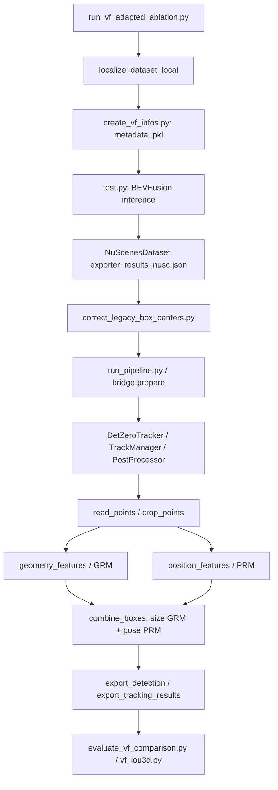

# Review pipeline VF: BEVFusion → tracking → GRM/PRM

Ngày rà soát: 13/10/2026. Phạm vi: code checkout hiện tại và artifact của
`outputs/vf-car-truck-sweeps2-01`, gồm threshold sweep `KTEQV3`.

## Kết luận

Pipeline nối dữ liệu nhất quán theo các kiểm tra hiện có: đúng token/index,
đúng chuỗi tọa độ camera/LiDAR/global, thứ tự kích thước được chuyển đổi
đúng tại bridge, crop và feature encoding khớp công thức gốc. Chưa phát
hiện bằng chứng một lỗi nối dữ liệu làm sai toàn bộ detection/tracking/refining.

Tuy nhiên đây là **adapter VF sử dụng model/thuật toán DetZero**, chưa phải
tái lập nguyên pipeline huấn luyện/đánh giá Waymo. Không thể chứng nhận
calibration vật lý, phân bố intensity, định nghĩa class/box và độ chính xác
transfer của checkpoint chỉ bằng test nạp trọng số hoặc tensor shape.

Một khác biệt preprocessing đã xác định rõ: Waymo crop gốc dùng
`tanh(intensity)`; lần VF dùng `intensity/255`. Policy `size_policy=grm`
còn ép nhận size GRM cho mọi track hợp lệ. Với pedestrian, size này đã làm
AP IoU 3D suy giảm trong artifact thực tế. Đây là điểm cần ưu tiên xử lý,
không chỉ threshold.

## Sơ đồ thực thi



GRM và PRM đều lấy track/crop ban đầu. Trong adapter này, PRM **không nhận
box đã sửa size bởi GRM**; hai kết quả được ghép ở cuối.

## 1. Script điều phối và chuẩn bị dữ liệu

File: `tools/run_vf_adapted_ablation.py`.

- `localize()` trừ cùng một origin UTM khỏi ego pose và annotation,
  giữ rotation, calibration, timestamp và file sensor. Đây là đổi gốc
  global để giảm lỗi float32, không phải đổi extrinsic hoặc sửa prediction.
- Gọi `tools/data_converter/create_vf_infos.py` với `max_sweeps=2`.
- Gọi `tools/test.py` bằng torchpack một tiến trình; data root và ann_file
  được override sang dataset_local, batch=1, workers=0, load_interval=1.
- Chạy center correction cho checkpoint `bevfusion-det.pth` đã chỉ định.
- Chạy ba nhánh DetZero: none (tracking), geometry (GRM), full (GRM+PRM).
- Đánh giá mỗi nhánh bằng evaluator VF custom.

Lần threshold sweep dùng `tools/run_vf_threshold_sweep.sh`: không chạy lại
BEVFusion, chỉ chạy lại toàn bộ tracking/crop/refinement với min_score khác.

### Metadata

`tools/data_converter/create_vf_infos.py:create_vf_infos()`:

1. Đọc tables nuScenes-format và lịch sử sensor.
2. `obtain_sensor2top()` tính sensor→ego→global→ego hiện tại→LiDAR hiện tại.
3. Ghi camera intrinsics, sensor2lidar, ego pose, path và timestamp.
4. Lấy các sweep thực sự trong quá khứ, không vượt scene và max age.
5. Ghi `dataset_local/bevfusion_infos_val.pkl`.

GT có trong info phục vụ dataset/evaluator, nhưng test pipeline của lần
này chỉ collect ảnh, points và ma trận; không đưa GT vào model detection.
Bridge/tracking/crop/refinement không đọc annotation GT.

Artifact: 156 info; số sweep mỗi sample là 0, 1, 2 tương ứng 1, 1, 154
sample. Độ tuổi sweep thực tế khoảng 0.100–0.400 s.

## 2. Detection BEVFusion

Entry point: `tools/test.py:main()`.

Config leaf:
`configs/nuscenes/det/transfusion/secfpn/camera+lidar/swint_v0p075/vf6_nav/sweeps2.yaml`.
Các default.yaml cha dựng model Swin/DepthLSS/SparseEncoder/ConvFuser/TransFusion.
Data root của config cha là NAV dataset, nhưng runner override đúng sang
dataset_local; không kết luận model đang đọc sai dataset chỉ từ default.yaml.

Luồng:

```text
tools/test.py
  → mmdet3d/datasets/builder.py: build_dataset/build_dataloader
  → mmdet3d/datasets/nuscenes_dataset.py: load_annotations/get_data_info
  → mmdet3d/datasets/custom_3d.py: prepare_test_data
  → mmdet3d/datasets/pipelines/compose.py: Compose
  → loading.py + transforms_3d.py + formating.py
  → mmdet3d/models/builder.py: build_model
  → mmdet3d/models/fusion_models/bevfusion.py: forward/forward_single
```

Test pipeline:

```text
LoadMultiViewImageFromFiles
→ LoadPointsFromFile
→ LoadPointsFromMultiSweeps (2)
→ ImageAug3D (deterministic inference)
→ GlobalRotScaleTrans (identity inference)
→ PointsRangeFilter
→ ImageNormalize
→ DefaultFormatBundle3D
→ Collect3D (img, points, matrices)
```

Không đọc radar, GTDepth, map hay annotation loader trong pipeline này.
Model vẫn dự đoán **10 lớp nuScenes**, không phải head 3 lớp của checkpoint
Phenikaa `epoch_3.pth`.

### Bên trong BEVFusion

- Camera: `bevfusion.py:extract_camera_features()` → SwinTransformer qua
  registry MMDetection → `models/necks/generalized_lss.py` →
  `models/vtransforms/depth_lss.py` và `vtransforms/base.py`.
- DepthLSS chiếu LiDAR lên ảnh để tạo sparse depth, dự đoán phân bố depth,
  lift feature rồi pool vào BEV. Đây là feature học được, không phải ảnh BEV.
- LiDAR: `bevfusion.py:voxelize()/extract_features()` → Voxelization →
  `models/backbones/sparse_encoder.py`.
- Fusion: `models/fusers/conv.py` concatenate camera BEV và LiDAR BEV,
  Conv2D/BN/ReLU.
- Decoder BEV: `models/backbones/second.py` → `models/necks/second.py`.
- Detection: `models/heads/bbox/transfusion.py:forward_single()/get_bboxes()`
  → `core/bbox/coders/transfusion_bbox_coder.py:decode()`.

Ảnh input `[B,6,3,256,704]`; camera BEV `[B,80,180,180]`; LiDAR BEV
`[B,256,180,180]`; fused BEV `[B,256,180,180]`; decoder output
`[B,512,180,180]`. Head chọn 200 proposal và dự đoán box, class, score,
velocity. Shapes được đối chiếu config/code, không phải rerun CUDA trong review.

Config có bbox score_threshold=0.0 và post-box nms_type=null. Vẫn có
lọc local maximum heatmap trước chọn proposal và lọc range. Vì vậy nhiều
candidate confidence thấp trong JSON là hành vi dự kiến của config.

### Export detector và convention Z

`tools/test.py` → `NuScenesDataset.format_results()` → `_format_bbox()` →
`output_to_nusc_box()` → `lidar_nusc_box_to_global()`.

- Tensor box nội bộ có yaw/dimension convention legacy.
- Exporter dùng gravity_center và yaw `-yaw-pi/2`, chuyển LiDAR→ego→global.
- Ghi `baseline/predictions.pkl` và `baseline/results_nusc.json`.
- `tools/correct_legacy_box_centers.py:correct()` tạo JSON mới,
  trừ `R_global_lidar[:,2] * h/2` khỏi center, không sửa raw JSON.

Correction này chỉ đúng với convention checkpoint MIT legacy đã audit.
Không dùng nó mặc định cho checkpoint retrain. Artifact xác nhận correction
đúng một lần và hash raw/calibration khớp metadata correction.

Detector runner hiện không truyền `--strict-checkpoint`, dù `tools/test.py`
đã hỗ trợ cờ này. Không có detection log trong các file chuyển sang local
để xác nhận toàn bộ warning load; lần chạy kiểm chứng trên máy GPU nên dùng
strict load. Checkpoint GRM/PRM thì đã dùng strict=True.

## 3. Bridge vào DetZero

`DetZero-main-2/integration/run_pipeline.py:main()` gọi
`integration/bridge.py:prepare()`.

Bridge đọc JSON **đã correction**, kiểm tra token/scene/frame đầy đủ,
sort theo timestamp, lọc class và score≥min_score. Nó đổi box từ
`[center_xyz,w,l,h,quaternion]` sang `[x,y,z,l,w,h,yaw]`.

Mapping chọn model:

| Detector class | Nhóm DetZero | Checkpoint prefix |
|---|---|---|
| car, truck | Vehicle | vehicle |
| motorcycle | Cyclist | cyclist |
| pedestrian | Pedestrian | pedestrian |

Tracking vẫn chạy riêng từng class nuScenes, không trộn car với truck.
Cyclist→motorcycle là reuse checkpoint khác domain/class definition,
không phải bằng chứng checkpoint gốc đã train trên VF motorcycle.

`source_index` giữ vị trí prediction trong JSON, dùng để ghi box sửa trở
lại đúng observation. `pose=T_global_ego @ T_ego_lidar` dùng cho LiDAR crop.

## 4. Tracking

```text
run_pipeline.py:run_tracking()
→ tracking/detzero_track/models/detzero_tracker.py:forward()
→ tracking_modules/track_manager.py:forward()
→ kalman_filter/kalman_filter.py
→ data_association/data_association.py
→ data_association/distance.py
→ tracking_modules/post_process.py
```

Config: `tracking/tools/cfgs/tk_model_cfgs/nuscenes_detzero_track.yaml`.

- Kalman state `[x,y,z,vx,vy]` dùng timestamp thật cho F/DELTA_T.
- Association one_stage, IoU BEV, GNN/Hungarian assignment.
- Gate IoU: Vehicle 0.2, Pedestrian/Cyclist 0.1.
- Second-stage score threshold trong YAML không hoạt động ở one_stage.
- Có merge và reverse tracking; pipeline offline, dùng cả frame tương lai.
- PostProcessor xóa track dưới 2 hit, trim đầu/cuối unmatched,
  velocity optimize, motion classify và static drift handling.

KalmanFilter.update() giữ center/size/yaw của observation detector;
filter chủ yếu giúp prediction để association và estimate velocity.
Do đó tracking-only không nhất thiết sửa detection geometry, và AP IoU
không đổi trong artifact là phù hợp với code.

`max_gap_seconds=0.6` được đổi sang số frame bằng ceil(max_gap/median_dt).
Median dt thực tế ~0.199999 s cho death_age=4, không phải giới hạn gap
đúng từng microsecond. Timestamps cập nhật F theo dt thật, nhưng PRM không
nhận dt như một feature riêng. Đúng timing tracker không tự chứng nhận
refiner tương đương phân bố thời gian lúc huấn luyện.

## 5. Crop LiDAR cho refining

`run_pipeline.py:collect_track_pointclouds()` →
`bridge.py:read_points()` → `bridge.py:crop_points()`.

Đọc keyframe LiDAR hiện tại, bỏ điểm không hữu hạn, đổi XYZ LiDAR→global,
normalize intensity, crop trong box track phóng 1.1 lần cả ba chiều.
Không crop theo GT. Không dùng cloud 2-sweep của detector ở bước này;
thay vào đó refiner gom crop nhiều keyframe dọc theo track.

Original Waymo crop trong `daemon/prepare_object_data.py` cũng có enlarge
scale mặc định 1.1 và transform sang global, nhưng intensity là tanh.
Adapter VF mặc định unit=intensity/255. Đây là khác biệt thực tế với
preprocessing gốc, chưa được calibration để tái tạo phân bố training.

Mẫu intensity lấy mỗi 100 điểm trên 156 keyframe VF: 423.077 giá trị,
min/median/P95/P99/max = 0/6/61/94/255; không có giá trị >255 trong mẫu.
Median sau unit ~0.0235, còn tanh(6) gần 1. Vì vậy không đổi thẳng sang
tanh raw VF rồi gọi là đúng preprocessing Waymo; cần đo/ablate có kiểm soát.

## 6. GRM

```text
run_pipeline.py:run_refining()
→ bridge.py:geometry_features()
→ refining/detzero_refine/models/geometry_refine_model.py
→ models/refine_template.py:forward()
→ models/modules/geometry_transformer.py
→ models/modules/head/geometry_head.py
→ models/modules/target_assign.py:decode_torch()
```

Load model từ `refining/tools/cfgs/ref_model_cfgs/{class}_grm_model.yaml`
và `{class}_grm_model.pth`, strict=True, eval(), no_grad().

- Chọn top 3 observation theo score làm query.
- Đưa từng crop về hệ box của observation đó, set query center/yaw=0.
- Query: 256 point, 4 channel XYZ/intensity.
- Memory: 4096 point gom toàn track, 11 channel XYZ/intensity,
  khoảng cách đến 6 mặt box và score.
- Model dự đoán kích thước chung cho track.

`size_policy=grm` nhận size model nếu hữu hạn và dương; không gate bằng
GT hay ratio với detector. `auto` gate ratio 0.75–1.25 so với median size
detector; nếu từ chối thì dùng median, không dùng nguyên size từng frame.
`detector_prior` cũng dùng median track, không đồng nghĩa giữ detector
per-frame. Tổng crop <10 point mới bị skip; track có điểm không bảo đảm
association hoặc crop sạch.

Pedestrian config có các anchor size theo domain Waymo; model phát size
không khớp GT VF đã được đo trực tiếp trong báo cáo detection audit.

## 7. PRM và ghép box

```text
run_pipeline.py:position_chunks()
→ bridge.py:position_features()
→ models/position_refine_model.py
→ models/refine_template.py:forward()
→ models/modules/position_transformer.py
→ models/modules/head/position_head.py
→ models/modules/target_assign.py:decode_torch()
→ bridge.py:position_to_global()
→ bridge.py:combine_boxes()
```

PRM lấy box ở giữa cửa sổ làm origin, đưa toàn bộ track/crop về hệ đó.
Query có 256 point/frame, memory 48 point/frame, 200 frame có padding mask.
Features: XYZ/intensity + point-to-8-corners-and-center + score, 32 channel.
Cyclist thêm class one-hot thành 35 channel, khớp config cyclist PRM.

PRM nhận track box ban đầu, không nhận size GRM. Track dài được chia core
168 observation cộng tối đa 16 context mỗi phía. Model sửa center/yaw,
chuyển kết quả về global; combine lấy size GRM và pose PRM.
Với z_policy=center, Z từ PRM được giữ; preserve_bottom là policy khác,
không phải tự ước lượng mặt đường.

## 8. Export và evaluation

`bridge.py:export_detection()` copy JSON detector gốc, chỉ thay box matched
theo source_index, ưu tiên track dài và không ghi cùng prediction hai lần.
Giữ class/score/velocity/attribute detector. Box bị threshold loại khỏi
tracking hoặc track bị xóa vẫn có trong detection refined.

`run_pipeline.py:export_tracking_results()` chỉ xuất observation matched
có ID, không xuất unmatched ngoại suy; tính velocity từ center/time.
Gap fill có code riêng nhưng **không bật** trong lần sweep này.

```text
results_nusc_detzero_refined.json
→ tools/evaluate_vf_comparison.py
  → nuScenes SDK center-distance AP/TP errors
  → tools/vf_iou3d.py custom greedy full-recall 3D IoU AP
```

GT chỉ được dùng ở evaluator. Association IoU BEV không phải tiêu chí
TP/FP detection với GT. Custom IoU AP không phải official Waymo metric.

## 9. Bằng chứng và giới hạn kiểm tra

- 936 camera→LiDAR metadata matrices khớp homogeneous transform chain,
  max absolute error ~2.22e-14. Đây là consistency toán học, không chứng
  nhận extrinsic vật lý đo ngoài hiện trường.
- Correction 21.400 box khớp hash raw/calibration và không bị áp hai lần.
- 26 regression tests đạt; 1 skip vì thiếu Torchpack, 1 config test không
  chạy được do ModuleNotFoundError Torchpack trên Mac. Hai test NAV
  transform/history chạy riêng đều đạt. Không coi lỗi môi trường này là
  lỗi inference trên máy công ty.
- Đối chiếu các method preprocessing gốc bằng AST để tránh import CUDA
  dataset extension: feature GRM và PRM (Pedestrian/Cyclist) khớp bridge
  trên toy sparse track, cùng intensity, không stochastic downsampling.
  Đây không phải kiểm chứng phân bố dữ liệu hoặc kết quả model trên VF.
- Chưa rerun BEVFusion CUDA/strict checkpoint trên Mac. Commit của một
  run cũ không có object trong checkout local nên chưa diff được toàn bộ
  source snapshot cũ với code hiện tại. Dùng artifact/hash của run để
  đối chiếu những contract đã ghi lại.

## 10. Ưu tiên thí nghiệm tiếp theo

1. Xác nhận strict load detector và hình chiếu camera/LiDAR/GT trên các
   frame pedestrian nghi ngờ, giữ nguyên convention correction đã audit.
2. Giữ detector size cho pedestrian làm đối chứng; tách GRM/PRM và gate
   size theo class. Không tăng ngưỡng chung để che việc refiner làm hỏng box.
3. Đo khác biệt intensity với dataset/checkpoint training và ablate
   normalization riêng, không đổi đồng thời threshold/size policy.
4. Kiểm chứng định nghĩa Rider/Pedestrian và full-body/visible-body của GT.
5. Chọn threshold trên validation, xác nhận bằng scene khác. Scene này
   có frame tương quan; không dùng mức tốt nhất để khẳng định tổng quát hóa.

Các bằng chứng định lượng chi tiết đã có tại
`outputs/vf-car-truck-sweeps2-01/analysis/REPORT_VI.md` và
`threshold_sweep_KTEQV3/ANALYSIS_VI.md`. Review này không sửa model, GT,
prediction hoặc policy chạy mặc định.
